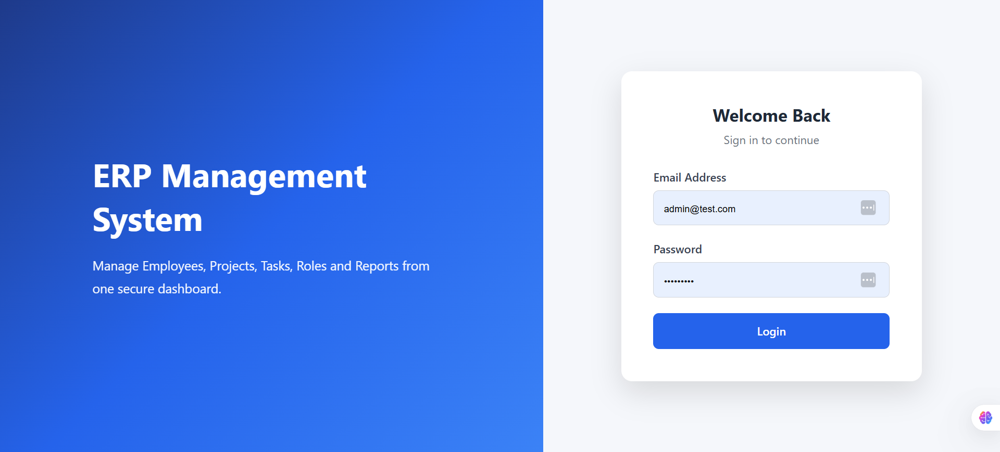
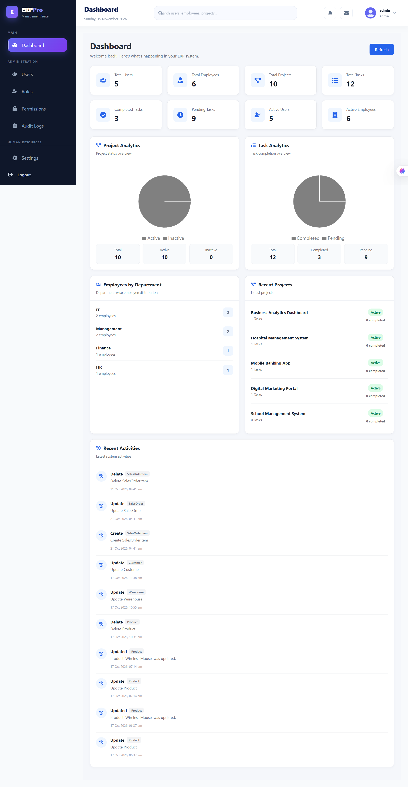
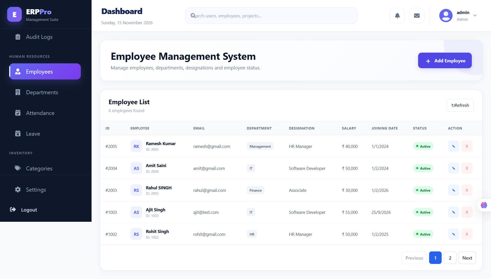
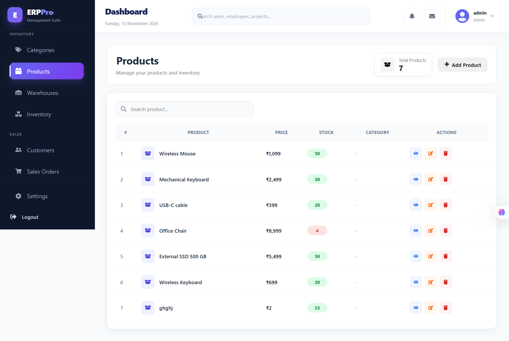
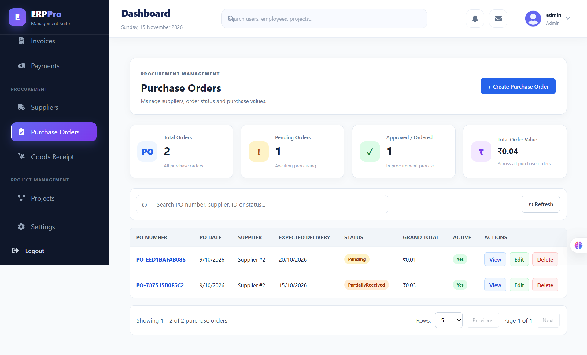
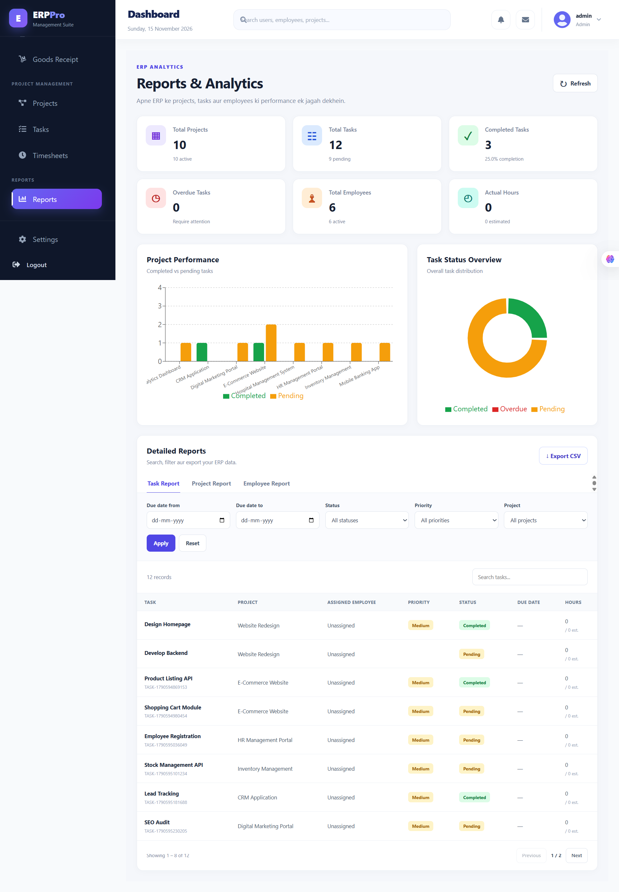

# Employee Resource Planning System (ERP)

A full-stack Enterprise Resource Planning (ERP) application designed to streamline employee administration and business operations. The backend is built using **ASP.NET Core Web API, C#, Entity Framework Core, and Microsoft SQL Server**, following a layered architecture.

The application provides centralized management of users, roles, permissions, employees, products, purchasing operations, and other business workflows.

## Overview

The Employee Resource Planning System aims to simplify organizational operations through a centralized ERP platform.

The backend uses a modular, layered architecture to separate API responsibilities, business logic, domain models, and infrastructure concerns.

## Key Features

- **User Management:** Manage application users and their information.
- **Authentication:** JWT-based authentication.
- **Role and Permission Management:** Manage roles and assign permissions.
- **Employee Management:** Maintain employee records.
- **Product Management:** Manage products and categories.
- **Supplier Management:** Maintain supplier information.
- **Purchase Management:** Manage purchase orders and related operations.
- **Goods Receipt:** Handle goods receipt workflows.
- **Notifications and Messaging:** Support application notifications and communication.
- **Search:** Search across supported application data.
- **Reporting:** Generate business-related reports.
- **Payment Integration:** Stripe.NET integration.

## Technology Stack

### Backend
- C#
- ASP.NET Core Web API
- .NET 8
- Entity Framework Core 8
- AutoMapper
- FluentValidation
- BCrypt.Net
- JWT Authentication
- Swagger / Swashbuckle

### Database
- Microsoft SQL Server
- SQL Server Management Studio (SSMS)

### Payment Integration
- Stripe.NET

### Development Tools
- Visual Studio 2022
- Visual Studio Code
- Postman
- Git and GitHub

## Architecture

The backend follows a layered architecture.

```text
                 React Frontend
                       |
                       | HTTP / REST API
                       |
                       v
                 ERP.APIMain
                 (API Layer)
                       |
                       v
              ERP.APPLICATIONBUSINESS
               (Business Logic)
                       |
              -------------------
              |                 |
              v                 v
       ERP.DOMAINMODELS   ERP.INFRASTRUCTUREDATA
        (Domain Layer)     (Data Access Layer)
                                |
                                v
                         Entity Framework Core
                                |
                                v
                         Microsoft SQL Server
```

### Project Responsibilities

| Project | Responsibility |
|---|---|
| ERP.APIMain | API controllers, configuration, authentication and HTTP endpoints |
| ERP.APPLICATIONBUSINESS | Business logic, application services and validations |
| ERP.DOMAINMODELS | Domain entities and application models |
| ERP.INFRASTRUCTUREDATA | Database context, repositories and data access |
| ERP.SHAREDUTILITY | Shared utilities and common functionality |

## Project Structure

```text
Employee-Resource-Planning/
│
├── ERP.APIMain/
│   ├── Controllers/
│   ├── Middleware/
│   ├── Program.cs
│   └── ERP.APIMain.csproj
│
├── ERP.APPLICATIONBUSINESS/
│   ├── Interfaces/
│   ├── Services/
│   └── ERP.APPLICATIONBUSINESS.csproj
│
├── ERP.DOMAINMODELS/
│   ├── Entities/
│   ├── DTOs/
│   ├── Enums/
│   └── ERP.DOMAINMODELS.csproj
│
├── ERP.INFRASTRUCTUREDATA/
│   ├── Data/
│   ├── Repositories/
│   ├── Migrations/
│   └── ERP.INFRASTRUCTUREDATA.csproj
│
├── ERP.SHAREDUTILITY/
│   ├── Helpers/
│   ├── Constants/
│   └── ERP.SHAREDUTILITY.csproj
│
├── ERPSystem.sln
├── .gitignore
├── LICENSE
└── README.md
```

*Note: The structure above describes the logical organization. Verify individual folder names against the latest source before relying on every path.*

## Prerequisites

Install the following:

- [.NET SDK](https://dotnet.microsoft.com/download)
- [Microsoft SQL Server](https://www.microsoft.com/sql-server)
- [SQL Server Management Studio](https://learn.microsoft.com/sql/ssms/)
- [Visual Studio 2022](https://visualstudio.microsoft.com/)
- [Git](https://git-scm.com/)

## Installation and Setup

### 1. Clone the Repository

```bash
git clone https://github.com/Developer-Ajit515/Employee-Resource-Planning.git

cd Employee-Resource-Planning
```

### 2. Configure SQL Server

Create your SQL Server database.

Configure the database connection using the connection string key expected by `Program.cs` and your database configuration.

Example:

```json
{
  "ConnectionStrings": {
    "DefaultConnection": "Server=(localdb)\\MSSQLLocalDB;Database=Db_ERPSystem;Trusted_Connection=True;TrustServerCertificate=True;"
  }
}
```

Replace `YOUR_SERVER` with your SQL Server instance.

**Security:** Never commit database passwords, JWT secrets, or Stripe secret keys. Use .NET User Secrets or environment variables for sensitive configuration.

### 3. Restore Dependencies

Run:

```bash
dotnet restore ERPSystem.sln
```

### 4. Apply Database Migrations

The project keeps its migrations in the Infrastructure project.

Run:

```bash
dotnet ef database update --project ERP.INFRASTRUCTUREDATA/ERP.INFRASTRUCTUREDATA.csproj --startup-project ERP.APIMain/ERP.APIMain.csproj
```

Ensure the EF Core CLI tool and design-time configuration are available.

### 5. Build the Solution

```bash
dotnet build ERPSystem.sln
```

### 6. Run the Backend API

```bash
dotnet run --project ERP.APIMain/ERP.APIMain.csproj
```

Check the terminal output for the application URL.

### 7. Access Swagger

Open the Swagger URL displayed by the application.

Swagger provides an interface to inspect and test the available API endpoints.

## Authentication

The backend includes JWT-based authentication.

For protected endpoints, send the access token in the HTTP Authorization header:

```http
Authorization: Bearer YOUR_JWT_TOKEN
```

Password hashing is supported through BCrypt.

## Database

The application uses Microsoft SQL Server with Entity Framework Core for database operations.

Database migrations are maintained in the Infrastructure project.

## Frontend

The backend is designed to communicate with a React-based frontend through REST APIs.

**Repository note:** The React frontend is not currently included in this GitHub repository's root structure. Add the frontend source or provide its repository link to make the project independently reproducible as a complete full-stack application.

## Security Practices

- JWT-based authentication.
- BCrypt password hashing.
- Role and permission-based access control.
- Request validation.
- Secure configuration of sensitive credentials.
- HTTPS for production environments.
- Restricted CORS configuration.
- Avoid exposing sensitive employee and business information.

## Screenshots
## 📸 Application Screenshots

<table>
  <tr>
    <td align="center"><b>Login Page</b></td>
    <td align="center"><b>Admin Dashboard</b></td>
  </tr>
  <tr>
    <td></td>
    <td></td>
  </tr>
  <tr>
    <td align="center"><b>Employee Management</b></td>
    <td align="center"><b>Product Management</b></td>
  </tr>
  <tr>
    <td></td>
    <td></td>
  </tr>
  <tr>
    <td align="center"><b>Purchase Order</b></td>
    <td align="center"><b>Reports</b></td>
  </tr>
  <tr>
    <td></td>
    <td></td>
  </tr>
</table>

## Future Improvements

- Automated unit and integration testing.
- Docker containerization.
- CI/CD using GitHub Actions.
- Centralized logging and monitoring.
- Advanced reporting and analytics.
- Improved API documentation.
- Performance optimization and caching.
- Cloud deployment.

## Author

**Ajit Singh**

- GitHub: https://github.com/Developer-Ajit515
- LinkedIn: https://www.linkedin.com/in/ajit-singh-62836b158/

## License

This project is licensed under the MIT License. See the [LICENSE](LICENSE) file for details.

---

If you find this project useful, consider giving it a star on GitHub.
